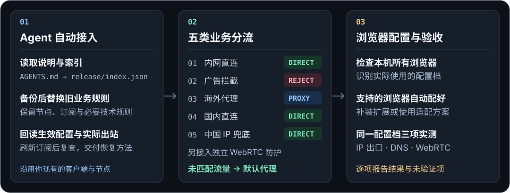
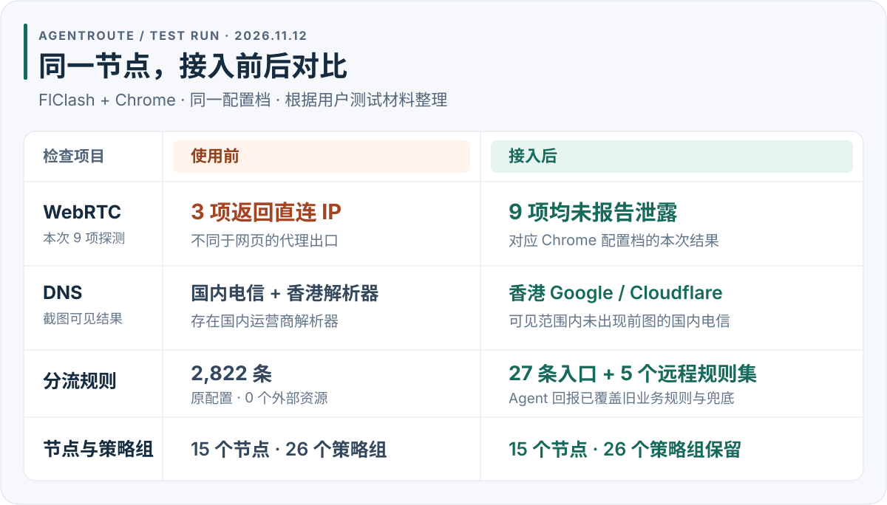

<div align="center">

# AgentRoute

<a id="about"></a>

**想用 Claude？把代理规则和浏览器防护交给 Agent。**

沿用你的客户端和节点。复制一段提示词，让 Agent 备份配置、替换旧规则、配好浏览器，再交付检测结果。

[](https://github.com/ryuu-restart/agent-route/actions/workflows/run.yml) [](https://github.com/ryuu-restart/agent-route/commits/release)

**[快速开始](#agent-prompt)** · [接入前后对比](#test-results) · [规则直链](#rule-subscriptions) · [浏览器验收](#browser-checks) · [官方微信群](#wechat-group)

</div>

<picture>
  <source media="(max-width: 767px)" srcset="assets/hero-mobile.svg">
  
</picture>

**先备份，再覆盖，最后实测。** 沿用节点与订阅，Agent 按客户端版本完成接入；规则每日校验发布，恢复方法随结果一起交付。

<a id="让我的-agent-接入"></a>
<a id="agent-prompt"></a>

## 快速开始

准备好**可用的代理客户端和节点**，复制下面的提示词，交给能操作本机文件和浏览器的 **Codex 等 Agent**。遇到系统或浏览器要求本人确认时，按 Agent 提示完成确认即可。

```text
请读取 https://raw.githubusercontent.com/ryuu-restart/agent-route/master/AGENTS.md 及其中的规则索引，按规范接入现用客户端。
我授权先备份，再替换旧业务分流和默认兜底，保留节点订阅与必要技术规则；安装 webrtc-guard，执行客户端重载和一次现有节点订阅刷新。
检查本机已安装的所有浏览器，在实际使用的配置档自动安装并配置 WebRTC 防护；我接受可能影响通话、会议和 P2P。
核对环境后直接执行，完成实际分流与 IP、DNS、WebRTC 检测，交付结果、备份与恢复方法；未核实项注明未验证。
```

> [!CAUTION]
> **禁止使用 Claude（包括 Claude Code 及其他基于 Claude 模型的 Agent）** 执行本项目的接入、复查或维护任务。

<a id="test-results"></a>

<details>
<summary><strong>接入前后对照：同一 Chrome 配置档、同一节点</strong></summary>

**同一个 Chrome 配置档，同一个节点。** 这次 FlClash + Chrome 试跑中，WebRTC 从 9 项中 3 项返回直连 IP，变为 9 项均未报告泄露。

<picture>
  <source media="(max-width: 767px)" srcset="assets/test-results-2026-11-12-mobile.svg">
  
</picture>

2026-11-12 用户试跑，来自截图与 Agent 回报：

- **Chrome WebRTC**：接入前 9 项中 3 项返回直连 IP；接入后 9 项均未报告泄露。
- **DNS 截图可见结果**：接入前为国内电信及香港解析器；接入后为香港 Google / Cloudflare，未出现前图的国内电信。
- **规则入口**：从 2,822 条、0 个外部资源，变为 27 条入口及 5 个远程规则集。
- **节点与策略组**：前后均为 15 个节点、26 个策略组。

[查看完整测试记录与未验证项](docs/TEST-RESULTS.md)

</details>

<a id="rule-subscriptions"></a>
<a id="按客户端拿规则"></a>

## 规则直链

五类业务规则按 **01 → 05** 匹配，首条命中即采用对应动作。未匹配的流量默认走代理；`PROXY` 由 Agent 映射到你的可用代理策略组。

| 顺序 | 业务规则 | 动作 | Mihomo | Surge / 小火箭 | sing-box |
| --- | --- | --- | --- | --- | --- |
| **01** | 内网直连 `private` | `DIRECT` | [YAML](https://raw.githubusercontent.com/ryuu-restart/agent-route/release/mihomo/private.yaml) | [LIST](https://raw.githubusercontent.com/ryuu-restart/agent-route/release/surge/private.list) | [JSON](https://raw.githubusercontent.com/ryuu-restart/agent-route/release/sing-box/private.json) |
| **02** | 广告拦截 `reject` | `REJECT` | [YAML](https://raw.githubusercontent.com/ryuu-restart/agent-route/release/mihomo/reject.yaml) | [LIST](https://raw.githubusercontent.com/ryuu-restart/agent-route/release/surge/reject.list) | [JSON](https://raw.githubusercontent.com/ryuu-restart/agent-route/release/sing-box/reject.json) |
| **03** | 海外代理 `proxy` | `PROXY` | [YAML](https://raw.githubusercontent.com/ryuu-restart/agent-route/release/mihomo/proxy.yaml) | [LIST](https://raw.githubusercontent.com/ryuu-restart/agent-route/release/surge/proxy.list) | [JSON](https://raw.githubusercontent.com/ryuu-restart/agent-route/release/sing-box/proxy.json) |
| **04** | 国内直连 `direct` | `DIRECT` | [YAML](https://raw.githubusercontent.com/ryuu-restart/agent-route/release/mihomo/direct.yaml) | [LIST](https://raw.githubusercontent.com/ryuu-restart/agent-route/release/surge/direct.list) | [JSON](https://raw.githubusercontent.com/ryuu-restart/agent-route/release/sing-box/direct.json) |
| **05** | 中国 IP 兜底 `cn-ip` | `DIRECT` | [YAML](https://raw.githubusercontent.com/ryuu-restart/agent-route/release/mihomo/cn-ip.yaml) | [LIST](https://raw.githubusercontent.com/ryuu-restart/agent-route/release/surge/cn-ip.list) | [JSON](https://raw.githubusercontent.com/ryuu-restart/agent-route/release/sing-box/cn-ip.json) |

**独立 WebRTC 防护**：放在必要技术规则之后、普通公网 DNS 地址例外和上述业务规则之前。

| 防护 | 动作 | Mihomo | Surge / 小火箭 | sing-box |
| --- | --- | --- | --- | --- |
| WebRTC 探测拦截 | `REJECT` | [YAML¹](https://raw.githubusercontent.com/ryuu-restart/agent-route/release/mihomo/webrtc-guard.yaml) | [LIST](https://raw.githubusercontent.com/ryuu-restart/agent-route/release/surge/webrtc-guard.list) | [JSON](https://raw.githubusercontent.com/ryuu-restart/agent-route/release/sing-box/webrtc-guard.json) |

¹ Mihomo 使用 `classical` 格式。防护拒绝已被客户端接管的常见探测，可能影响通话、会议及 P2P。[接入顺序与覆盖范围](docs/WEBRTC-GUARD.md)

<a id="记得经常更新"></a>

规则经校验后发布到 `release`，由客户端按设置刷新，建议间隔 **24 小时**。

<details>
<summary>按客户端取用：格式入口、完整索引与可选模板</summary>

**Agent 格式入口：** [Clash / Mihomo](https://raw.githubusercontent.com/ryuu-restart/agent-route/master/subscriptions/mihomo.json) · [Surge](https://raw.githubusercontent.com/ryuu-restart/agent-route/master/subscriptions/surge.json) · [Shadowrocket](https://raw.githubusercontent.com/ryuu-restart/agent-route/master/subscriptions/shadowrocket.json) · [sing-box](https://raw.githubusercontent.com/ryuu-restart/agent-route/master/subscriptions/sing-box.json) · [完整索引](https://raw.githubusercontent.com/ryuu-restart/agent-route/release/index.json)

[手动接入参考](docs/CLIENTS.md) · [可选模板与历史验证](examples/README.md)

</details>

<a id="browser-checks"></a>

## 浏览器防护与验收

1. **Agent 自动配置，再回读确认。** 检查本机所有浏览器，在实际使用的配置档操作。Chrome / Edge 补装并启用 [WebRTC Network Limiter](https://chromewebstore.google.com/detail/webrtc-network-limiter/npeicpdbkakmehahjeeohfdhnlpdklia)，设为 **Use my proxy server (if present)**（`disable_non_proxied_udp`）；已有扩展也核对设置。
2. **Agent 在同一配置档完成三项检测。** 交付网页出口、DNS 解析器与 WebRTC 结果，核对适用的音视频功能。你也可以从下面三个入口复测。

**[IP 检测](https://ippure.com/) · [DNS 检测](https://ippure.com/DNS-Leak-Detect.html) · [WebRTC 检测](https://ippure.com/Browser-WebRTC-Leak-Detect.html)**

<details>
<summary>其他浏览器、受限情况与完整验收标准</summary>

其他浏览器由 Agent 按实际版本继续配置：Firefox 核对原生入口；Safari 优先核对网络层的 UDP 与 IPv6 路径。系统或浏览器要求本人确认时，Agent 准备好步骤再提示你；没有可核实方案的标为待配置。

结果还应包含旧规则替换情况、Claude 请求的实际出站、订阅刷新后的复查、备份与恢复方法；未核实项注明未验证。

[浏览器配置与官方依据](docs/DNS-WEBRTC.md#webrtc-methods) · [完整验收标准](docs/DNS-WEBRTC.md#acceptance)

</details>

<a id="反馈问题"></a>
<a id="wechat-group"></a>

## 有问题，一起排查

微信扫码加入 **AgentRoute 官方交流群**。接入卡住、规则没生效，或看不懂检测结果，都可以来交流。


二维码在 **2026 年 11 月 20 日前有效**。[查看原图](assets/wechat-group-qr.png) · [提交 GitHub Issue](https://github.com/ryuu-restart/agent-route/issues/new/choose)

反馈时附上系统与客户端版本；请隐去订阅链接、节点地址、凭据和真实 IP。[脱敏说明](AGENTS.md#issue-feedback)

<details>
<summary>进阶文档、规则来源与许可</summary>

[Agent 接入说明](AGENTS.md) · [可选模板与历史验证](examples/README.md) · [DNS / WebRTC 验收](docs/DNS-WEBRTC.md) · [同步与回退](docs/SYNC.md) · [维护说明](docs/MAINTAINING.md)

规则来源与处理方式见 [NOTICE](NOTICE.md)、[sources.json](sources.json)；[本仓库许可](LICENSE)与[上游许可](licenses/)分别适用。

</details>
