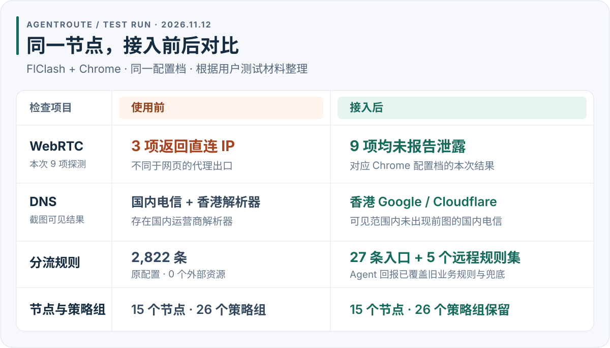

# 一次接入前后的测试记录

[返回首页](../README.md#test-results) · [复制接入提示词](../README.md#agent-prompt)

2026-11-12，用户提供了接入前后的客户端、IP、DNS 和 WebRTC 截图，以及执行 Agent 的结果回报。用户确认两组 IPPure 截图使用**同一个 Chrome 配置档、同一个节点**。本页整理这些材料，完整 IP、订阅名称、配置档名称及本地路径已省略；对比图是数据摘要。

**本案例的结果是部分通过。** Chrome 的本次 WebRTC 探测未报告泄露，Safari 和全设备 IPv6 接管仍未通过，成功刷新节点订阅后的持久性尚未验证。维护侧核对了所提供的图片，未重新操作目标设备或独立复测。

## 测试环境与证据范围

| 项目 | 本次记录 |
| --- | --- |
| 日期 | 2026-11-12，按截图文件名及用户回报记录 |
| 系统 | macOS，未提供系统具体版本 |
| 客户端 / 内核 | FlClash 0.9.3 / Mihomo 1.19.33，来自 Agent 回报 |
| 浏览器 | Chrome 157.0.8103.78 的两个实际配置档；Safari 27.2 的默认配置档，来自 Agent 回报 |
| 对照条件 | 用户确认前后 IPPure 截图来自同一 Chrome 配置档、同一节点；第二个 Chrome 配置档的结果仅见 Agent 回报 |
| 检测工具 | [IPPure IP 检测](https://ippure.com/)、[DNS 检测](https://ippure.com/DNS-Leak-Detect.html)、[WebRTC 检测](https://ippure.com/Browser-WebRTC-Leak-Detect.html) |
| 版本留档缺口 | 材料未附实际使用的源码完整 SHA、规则 `release` SHA 或 `generation`，不能绑定到某一规则发布代 |

这些版本用于描述本次环境，不构成其他版本的兼容性结论。原始截图含网络与订阅信息，未随公开仓库上传。

## 前后对照

<picture>
  <source media="(max-width: 767px)" srcset="../assets/test-results-2026-11-12-mobile.svg">
  
</picture>

| 检查项 | 接入前 | 接入后 | 可以得出的结论 |
| --- | --- | --- | --- |
| 网页出口与 IPPure 评分 | 香港出口，35% | 相同出口 IP，仍为 35% | 本次未观察到出口或评分变化 |
| DNS 检测 | 可见结果包含中国电信解析器及香港 Google / Cloudflare | 可见结果为香港 Google / Cloudflare，未出现前图中的国内电信解析器 | 本次截图可见范围内的解析器列表有变化；截图未包含完整列表底部 |
| Chrome WebRTC | 9 项中有 3 项返回不同于网页出口的国内公网 IPv4，另外 6 项返回网页出口 IP | 9 项均显示“未检测到 WebRTC IP 泄露” | 本次页面探测未报告泄露；不据此推断所有 WebRTC 通话可用或永久不会泄露 |
| 客户端规则 | 2,822 条规则、0 个外部资源，扩展模式为“标准” | 27 条规则、5 个外部资源，扩展模式为“脚本” | 截图显示配置组织发生变化；旧业务规则移除及实际命中由 Agent 回报补充 |
| 原有资源 | 15 个节点、26 个策略组 | 15 个节点、26 个策略组 | 前后数量一致；Agent 回报保留原有节点订阅 |

**27 条是运行配置中的规则入口，5 个远程规则集内部仍含大量条目。** 不能把这组数字解释为覆盖范围缩小，也没有吞吐量或延迟对照可支持“提速”结论。

## Agent 回报补充的验证

以下是用户提供的执行回报摘要，未附原始运行配置、流量日志或逐查询抓包，维护侧未独立复现。

| 项目 | 回报中的观察 | 本页记录的状态 |
| --- | --- | --- |
| 业务分流与兜底 | 旧业务规则与旧兜底已移除；`claude.ai`、`claude.com`、`anthropic.com` 命中 AgentRoute 代理规则，未匹配样本走默认代理 | 回报已验证这些样本；未验证 Claude 登录、对话或账号状态 |
| 其他规则样本 | 国内站点样本直连；`statsig.anthropic.com` 命中拦截 | 仅证明所报样本的动作；被拦域名对具体功能的影响未验证 |
| DNS 路径 | 国内样本使用直连阿里 DoH；Claude 与未知公网域名样本经代理使用 Cloudflare DoH；节点引导保留原服务商的直连加密解析；合成内网样本走局域网网关 | 回报称已按查询明细核对，不能由检测页的地区标签单独推出这些路径 |
| Chrome 两个配置档 | 官方扩展 0.2.1.4 已启用，回读为 `disable_non_proxied_udp`；两个配置档各 9 项 STUN 探测均未报告泄露 | 所报配置与探测通过；材料未展示安装过程，不能据此量化全程自动化或人工确认次数 |
| Safari 默认配置档 | 未找到该版本可核实的官方等效设置，原设置未改；3 项 STUN 探测返回不同于网页出口的国内公网 IPv4 | 未通过，待处理 |
| IPv6 接管 | IPv4 TUN 已核实；原生 IPv6 路由仍走物理接口 | 全设备 IPv6 接管未通过 |
| 节点订阅刷新 | 执行一次刷新，服务器返回 HTTP 403，订阅更新时间和缓存未变；之后回读旧规则未恢复 | 刷新失败；成功刷新后的覆盖持久性未验证 |
| 规则集更新 | 单独刷新 `private` 规则集成功，五组设置为每 24 小时更新 | 单组刷新已回报成功；后续定时刷新未观察 |
| 中国 IP 兜底 | 用于裸 IP 的配置已设置 | 实际出站未单独验证 |
| 备份与恢复 | 已交付备份位置及恢复步骤 | 有恢复方案；实际回滚演练未提供 |

Agent 对话显示本次执行用时约 16 分 10 秒。这是一次任务的记录，不能作为其他设备的完成时间承诺。

## 如何读这份结果

网页出口、DNS 路径、WebRTC、IPv6 和订阅持久性分别验收。这里的改善来自一次规则接入、DNS 配置和浏览器防护组合操作，现有材料不能单独归因到某一项改动，也不能推断 Claude 账号不会被限制。

复测时，在每个实际使用的浏览器配置档执行三项检测，并留存客户端、内核、浏览器版本和实际规则代。Safari、IPv6、成功订阅刷新后的复查，以及没有原始证据的项目，仍按未通过或未验证交付。[完整验收要求](DNS-WEBRTC.md)
